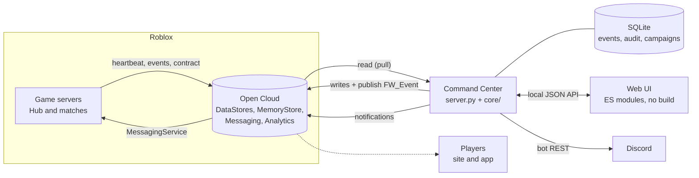

# Shroud War Command Center

A live-ops console for **Shroud War**, a Roblox PvP experience: live servers and players,
season automation, player actions, out-of-game notifications and Discord announcements,
from one page. It tells the operator *what to do now* instead of waiting to be asked.


> The interface and the detailed operating docs are in French (the team's language).
> Everything runs on the Python standard library; no build step for the front end.


## Try it in one command

```bash
docker compose up            # then open http://localhost:8787
# or, without Docker:
CC_DEMO=1 python server.py
```

Demo mode needs no key. It replaces Roblox and Discord with an in-memory universe that
answers like the real APIs: two hubs and four matches heartbeating every 5 s, a season that
closes every **10 minutes** (archive, then ranked payout a minute later), cheat flags,
honeypot hits, negative reviews, script-error bursts, a hub left on an old place version.
Every button works against it; nothing leaves the machine.

## What it does

| Area | What the operator gets |
|---|---|
| **Home** | One card per thing that needs attention (season closed, ranked payout, cheat, honeypot, crash burst, mixed place versions, manual setup tasks), each with a preview of exactly what will be published. Cards are computed by a pure function and keyed for idempotence. |
| **Live** | Every hub and match: mode, map, phase, players, FPS, memory, ping, place version; crash and freeze detection; restart old versions with an in-game banner. |
| **Players** | Connected roster and a full player sheet (profile, inventory and stash decoded, bans, honeypots); message, kick, ban, gold, item removal, gifts, with undo. |
| **Offline edits** | Write a player's data while they are offline without ever being overwritten: MemoryStore lock, presence checked twice, `etag`-conditioned write, original kept for undo. |
| **Notifications** | Roblox experience notifications (6 templates): audiences from the game's own indexes, one notification per player per day enforced by a local register, the strongest one kept. |
| **Broadcast** | Discord announcements with live variables (`{RUSFOR}`, `{IN_24H}`...), templates shared with a CLI, scheduler, audit journal. |
| **Health** | One probe per Open Cloud permission: the screen names the exact scope that is missing. |


## Architecture



- **The game pushes nothing to the outside world.** Servers write small, bounded state into
  Open Cloud stores (a heartbeat in a MemoryStore sorted map, events in a MemoryStore queue,
  a contract per place); the Command Center reads them. No public endpoint, no inbound
  traffic, nothing to secure on the game side. See [ADR 1](docs/ARCHITECTURE.md#adr-1-pull-not-push).
- **Commands reuse the game's existing messaging topic** (`FW_Event`), with ids, expiry and
  acknowledgements on the event bus. See [ADR 2](docs/ARCHITECTURE.md#adr-2-commands-travel-on-the-existing-fw_event-topic).
- **SQLite** keeps events, the audit journal, card state, command history, edit backups and
  the notification register. See [ADR 3](docs/ARCHITECTURE.md#adr-3-sqlite).
- **Every data flow** (source, transport, destination, rate, cost, failure mode) is listed in
  [docs/PIPELINES.md](docs/PIPELINES.md).

## Roblox limits, taken as design constraints

| Limit | Consequence here |
|---|---|
| No webhook for gameplay events | Pull model: the console reads what the game writes. |
| MemoryStore memory is shared by the whole universe (64 KB + 1.2 KB per player), matchmaking included | The event queue expires after 2 days and the game stops writing past 40 unread events; a counter goes in the heartbeat, never in the queue. |
| MessagingService messages are 1 KB, unacknowledged | Commands carry an id and an expiry; servers acknowledge on the event bus. |
| One experience notification per player per day; text created by hand in the Creator Hub | Local per-day register, priority order, campaigns paused on repeated 429s; templates only referenced by asset id. |
| A live server overwrites a player's data on its next save | Offline edits go through a lock the game waits on; online edits are sent to the hosting server. |
| Analytics need ~100 daily users for some features | Setup tasks wait for the threshold and turn into "now's the time" cards. |

## Repository layout

```
server.py            HTTP server, JSON API, static files (stdlib only)
announce.py          CLI for Discord announcements (shares templates with the UI)
bot.py               Discord runtime bot: tickets, /link, role sync (to be merged, lot 5b)
core/                domain modules: live registry, cards, events, commands, edits,
                     notifications, players, Faction War, ranked, analytics, demo world...
web/                 UI: index.html, css/, js/ (ES modules)
data/                seed data: announcement templates, settings, arsenal
docs/                PIPELINES.md, ARCHITECTURE.md (ADRs), OPERATIONS.md (French ops guide),
                     contract.schema.json
tests/               pytest suite (no network); tests/e2e: Playwright UI test with mocked API
tools/               setup_discord.py (one-shot server builder), Cloudflare webhook relay
```

## Run it for real

```bash
cp .env.example .env         # Open Cloud key, universe and place ids, Discord bot token
python server.py             # http://127.0.0.1:8787, opens the browser
```

The Open Cloud permissions to grant, and how to check them, are in
[docs/OPERATIONS.md](docs/OPERATIONS.md#clés-à-créer). Set `CC_GAME_ROOT` to the game
repository to read the data version from `SharedConfig.luau` and show the game's guides.

The server listens on `127.0.0.1` only and has **no authentication yet**: do not expose it
to a network. Hosting with Discord OAuth and roles is planned (see Roadmap).

## Quality

```bash
pip install -r requirements-dev.txt
pytest                      # cards, notification scheduler, commands, offline edits, demo world...
ruff check . && mypy        # lint and types
node tests/e2e/browser_live.cjs   # UI test against a mocked API (Playwright)
```

CI runs all of the above on Python 3.11 to 3.13, builds the Docker image and smoke-tests
it in demo mode.

## Roadmap

- **5b**: port the HTTP layer to FastAPI (same routes, protected by the current tests),
  async Open Cloud client, Discord bot merged into the same process.
- **6**: hosted 24/7 behind HTTPS with Discord OAuth and roles (moderators can kick and
  message, not wipe or give), Roblox webhooks (refunds, subscriptions, right-to-erasure) with
  HMAC verification, per-rule automation (manual by default; wipes, bans, restarts and
  erasure are never automatic), phone-friendly Home, Live and player sheet.

## License

[MIT](LICENSE). Security reports: see [SECURITY.md](SECURITY.md).
