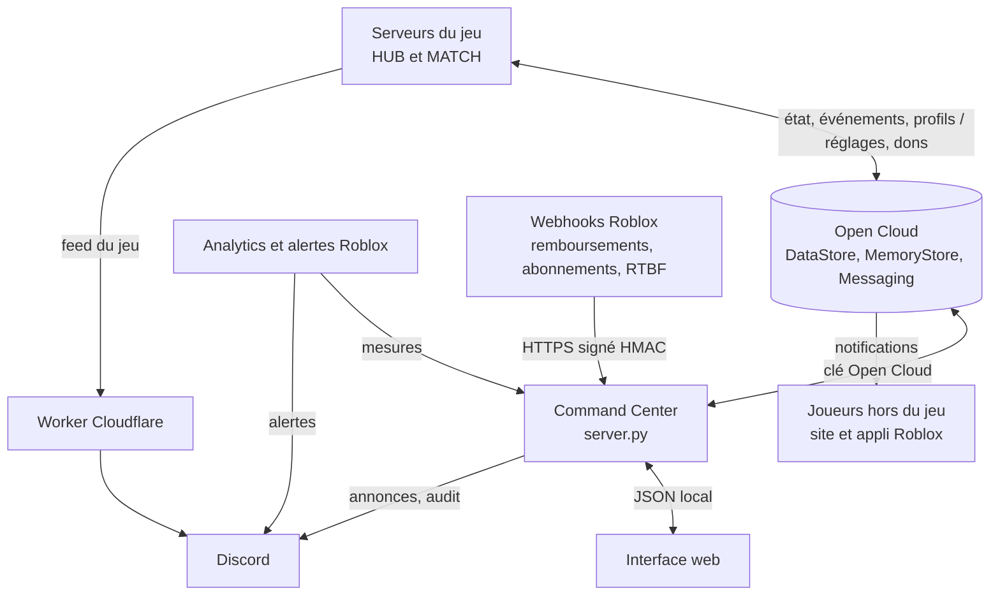

# Pipelines du Command Center

Ce document décrit chaque flux de données entre le jeu, Roblox, le Command Center (CC)
et Discord : d'où viennent les données, par où elles passent, où elles arrivent, à quel
rythme, ce que ça coûte et ce qui se passe quand un maillon tombe.

À tenir à jour à chaque nouvelle fonctionnalité : une ligne par flux, dans la bonne table.

## Les acteurs

| Acteur | Ce que c'est | Où il tourne |
|---|---|---|
| **Jeu, place HUB** | Lobby, file d'attente, boutique. `HUB` fait foi pour les fichiers jumeaux | Serveurs Roblox |
| **Jeu, place MATCH** | Serveurs de match (DUALS, DOMINATION, EXFIL, OPERATIONS), privés | Serveurs Roblox |
| **Open Cloud** | API HTTP de Roblox : DataStores, MemoryStore, MessagingService, Analytics, bans, notifications | Roblox |
| **Command Center** | `server.py` / `app.py` (API JSON, secrets, veilleur, automatisations, sauvegardes) et `web/` (interface, sans secret) | Ton PC (mode local, sans connexion) ou un serveur (Docker derrière Caddy, connexion Discord) |
| **Caddy** | Proxy HTTPS : certificat Let's Encrypt automatique, transmet au CC | Le même serveur, conteneur voisin |
| **Worker Cloudflare** | Relais des webhooks Discord du jeu, car Discord refuse les requêtes venues de Roblox | Cloudflare |
| **Discord** | Salons d'annonces, `#ops-log` (audit et alertes), salons du « GAME FEED » | Discord |
| **Bot Discord** (`core/bot.py`) | Tickets, journaux, rôles, liaison Roblox (`/link`), synchronisation des rôles | Dans le processus du CC (`CC_BOT=1`), ou seul (`python bot.py`) |
| **Navigateur** | Interface du CC ; reçoit les notifications système si tu les autorises | PC ou téléphone |

## 1. Jeu vers Command Center (lecture)

Le CC ne reçoit rien en push : il lit dans Open Cloud ce que le jeu y a écrit. Aucun
endpoint public n'est exposé.

| Fonction (écran) | Source | Transport | Destination | Rythme | Si ça échoue | Code |
|---|---|---|---|---|---|---|
| **Serveurs en direct** (Live, Fiches, barre d'état) | `CommandCenterBridge` sur chaque serveur : mode, map, phase, joueurs, FPS, mémoire, ping, réseau, temps de frame, version, compteurs Discord | SortedMap MemoryStore `CC_Servers_V1`, clé = JobId, TTL 300 s | Veilleur du CC et vues Live/Fiches, cache 3 s | Écriture toutes les 30 s et aux arrivées/départs (au plus une toutes les 2 s) ; lecture toutes les 5 s dans Live/Fiches, toutes les 20 s par le veilleur | Serveur planté : entrée sans battement, marquée « muet » après 75 s. Clé sans droit Memory Store : Live affiche l'erreur | `HUB/ServerStorage/Core/CommandCenterBridge.luau`, `core/live.py` |
| **Contrat de place** (Santé, Live) | Chaque place au démarrage : version des données, noms des magasins, offres | DataStore non versionné `CC_Contract`, clé `place_<PlaceId>` | `live.contracts()`, cache 5 min, 10 s si absent/illisible | Écrit seulement si le contenu change ; nouvelle tentative après 60 s en cas d’échec. Live actualise aussi les alertes | Contrat absent ou HUB/MATCH divergents : bannière d'alerte, le CC retombe sur ses propres noms de magasins | `CommandCenterBridge.luau`, `core/live.py` |
| **Fiche joueur : résumé** (Joueurs) | `PlayerDataService`, `XPService`, `Sanctions`, `ExfilClaims`, `HoneypotService` | DataStores `GlobalData`, `PlayerData_Skills&XP`, sanctions, dettes, `Honeypot` ; API user-restrictions (ban), Subscriptions, avatar | `players.summary()`, cache 60 s | Au clic seulement | Chaque section échoue seule et affiche son erreur | `core/players.py` |
| **Fiche joueur : inventaire et stash** | `InventoryServer`, `StashServer` (format `ItemSerializer` v2) | DataStores `PlayerData_Inventory`, `PlayerData_Stash` | Décodage dans le CC | Au clic sur l'onglet | Format inconnu : l'item brut est affiché | `core/players.py` |
| **Pièges anti-triche** (Sécurité, fiche joueur) | `HoneypotService` : remotes leurres appelées par un client | DataStore `Honeypot` (détail) et OrderedDataStore `HoneypotIndex` (liste) | Écran Sécurité | Écrit au premier déclenchement, puis à la sortie du joueur ; lu à l'ouverture | Rien n'est sanctionné automatiquement (politique « report ») | `HoneypotService.luau`, `core/roblox_api.py` |
| **Faction War** (Faction War, variables `{RUSFOR}`...) | `FactionWarService` | DataStore `FactionWar` : 8 clés `s_<semaine>_<faction>_<shard>`, `archive_<semaine>` ; OrderedDataStore `FWLB_w<semaine>_<faction>` | Écran et annonces | À l'ouverture ; les variables ne sont lues que si le texte les contient | Erreur affichée, annonce bloquée si une variable reste non résolue | `core/roblox_api.py`, `core/vars.py` |
| **Ranked** (Ranked, `{RANKED_TOP}`) | `RankedLadderService` | OrderedDataStore `RankedLB`, DataStore `RankedMeta` (8 shards) | Écran et aperçu des récompenses | À l'ouverture | Erreur affichée | `core/roblox_api.py`, `core/ranked_rewards.py` |
| **Tendances** (Tendances) | Roblox lui-même : pic de joueurs, crashs serveur par cause, FPS, mémoire, CPU serveur, crashs client, DataStore, joueurs actifs, revenus | Analytics Query API (POST puis attente du résultat) | Graphiques par place | À l'ouverture, cache 5 min ; 9 requêtes, 3 en parallèle | Droit absent : message dédié. Sous environ 100 joueurs actifs par jour : séries vides | `core/analytics.py`, `web/js/trends.js` |
| **Crashs serveur avec leur cause** (journal Live) | Roblox Analytics, métrique `ServerCrashCount` par Place et CrashType | Analytics Query API | Journal du veilleur, dédupliqué | Toutes les 5 min | Erreur visible dans le journal, pas d'événement | `core/watch.py` |
| **Hubs publics** (détection « Hub sans pont ») | Liste publique des serveurs Roblox | `games.roblox.com` (sans clé) | Veilleur | Toutes les 20 s | Ignoré | `core/watch.py` |
| **Santé du jeu** (Santé, `{PLAYING}`, `{VISITS}`) | Page publique de l'expérience | `games.roblox.com` (sans clé) | Écran Santé, variables | À l'ouverture | « Universe introuvable » ou erreur réseau | `core/roblox_api.py` |
| **Droits de la clé** (Santé, Tester les permissions) | Une requête inoffensive par droit | Open Cloud | Tableau des droits | Au clic seulement | Chaque ligne dit quel droit manque | `core/roblox_api.py` |
| **Événements du jeu** (Accueil, journal Live) | `CCEvents` : fin de saison et versement ranked (via `EventService.Publish`), sanction, anticheat, piège, avis de 1 ou 2 étoiles (via `DiscordFeed.ops`) | Queue MemoryStore `CC_Events_V1` (expiration 2 jours), puis `items:read` et `items:discard` ; compteur universel `CC_EventsBacklog` remis à zéro par le CC | Base `data/cc.db` (table `events`, dédoublonnée par id), cartes de l'Accueil, journal Live « jeu » | Dépôt à l'événement ; lecture toutes les 20 s par le veilleur | Au-delà de 40 événements non lus (60 pour la saison), le jeu cesse de déposer : la mémoire de l'univers ne peut pas déborder. Droit manquant : erreur dans l'état du veilleur | `HUB/ServerStorage/Core/CCEvents.luau`, `core/events.py` |
| **Erreurs de script** (Accueil, journal Live) | `CommandCenterBridge` : `ScriptContext.Error`, compté par minute, script le plus bavard | Champ `err` du battement du registre (s'écrase, ne s'accumule pas) | Journal « errors » et événement `error_spike` à partir de 20 erreurs par minute | Toutes les 30 s ; une alerte par serveur toutes les 10 min au plus | Rien de plus que le registre | `CommandCenterBridge.luau`, `core/watch.py` |
| **Accueil** (Accueil) | État du jeu (saison, archive, versement ranked, boost, modes, versions), événements du jeu, planificateur, tâches manuelles, santé du CC | Lectures Open Cloud et base locale | Cartes « À faire » triées par priorité, pastille, notice pour une nouvelle carte importante | À l'ouverture et toutes les 2 min, calcul gardé 30 s | Chaque source échoue seule ; une source absente ne fait pas de carte | `core/cards.py`, `web/js/home.js` |
| **Tâches manuelles** (Accueil, `#todo`) | Analytics `DailyActiveUsers` sur 7 jours, visites publiques, Asset IDs enregistrés, état du veilleur, coches locales | Analytics Query API, `games.roblox.com`, `data/todo_state.json` | Cartes « Configuration » de l'Accueil, ou « En attente » | Vérifié toutes les 30 min | Tâche affichée « à faire » avec l'erreur | `core/todo.py` |
| **Index d'activité** (audiences des notifications) | `NotificationServer` au Hub, à chaque arrivée d'un joueur | OrderedDataStore `CC_LastSeen`, clé = userId, valeur = heure Unix de la dernière arrivée | `notify.read_seen()` : filtre par plage d'heures (`entry >= a && entry <= b`), 100 par page | Écrit au plus une fois par heure et par joueur sur un serveur ; lu à l'aperçu d'une notification | Index vide (Hub pas encore publié) : audience vide avec une note ; droit Ordered Data Stores absent : erreur dans l'aperçu | `HUB/ServerScriptService/Core/NotificationServer.server.luau`, `core/notify.py` |

## 1 bis. Roblox vers Command Center : webhooks

Le seul flux qui entre de l'extérieur, d'où la console hébergée. Roblox appelle
`POST /webhooks/roblox` ; le CC vérifie, stocke, répond en moins de 5 s. Les actions viennent
ensuite, au clic, depuis l'Accueil.

| Événement | Vérification | Stockage | Devient |
|---|---|---|---|
| *Transaction Refunded* | `roblox-signature` : `t=…,v1=…`, base64(HMAC-SHA256(secret, `t.corps`)), comparaison en temps constant ; horodatage à ±5 min ; corps ≤ 64 Ko | `events` de `cc.db`, id `rbx:<NotificationId>` (un doublon est ignoré), journal (auteur « webhook ») | carte « Remboursement » (fiche du joueur, à retirer à la main pour un produit développeur) |
| *Subscription* résilié / remboursé | idem | idem | carte d'information (résilié) ou importante (remboursé) ; achat et renouvellement : journal seulement |
| *Right to Erasure* | idem | idem ; après effacement, l'événement perd l'identifiant du joueur | carte bloquante à 7 jours de l'échéance (30 jours), jamais ignorable ; « Effacer » : aperçu de chaque entrée, confirmation par l'identifiant tapé |
| *SampleNotification* (test du Creator Hub) | idem | idem | carte « Webhook Roblox reçu » pendant 24 h |

En panne : Roblox réessaie 5 fois puis invalide l'URL (à recoller dans le Creator Hub). Sans
`ROBLOX_WEBHOOK_SECRET`, la route répond 404 : rien n'est accepté sans signature.

**Effacement (RTBF)** : entrées supprimées dans les DataStores joueurs (profil, compétences,
inventaire, stash, sanctions, extraction, dettes du marché noir, pièges) et les
OrderedDataStores qui indexent le joueur (ranked, index des pièges, activité, classements
Faction War de chaque semaine). En base locale : liaisons Discord, copies d'édition, registre
des notifications, événements du jeu ; les lignes du journal qui le visent sont anonymisées.
Non couvert : annonces du marché noir (indexées par annonce).

## 2. Command Center vers le jeu (écriture)

Modèle commun : le CC **écrit** une valeur dans un DataStore (elle fait foi et survit aux
redémarrages), puis **publie** sur le topic MessagingService `FW_Event` pour que les
serveurs déjà ouverts la relisent tout de suite. Sans le publish, un serveur ouvert attend
son prochain cycle de lecture. Le jeu **revalide et plafonne** toujours ce qu'il lit.

| Fonction (écran) | Écrit | Publie (`FW_Event`) | Consommé par | Garde-fous | Trace Discord | Code |
|---|---|---|---|---|---|---|
| **Boost XP, or, guerre** (Boosts) | `FactionWar` / `event_override` | `{kind: "event"}` | `EventService` (au démarrage et au message) | Multiplicateurs et durée plafonnés ; « Arrêter » supprime la clé | Annonce optionnelle (modèle `boost`) | `core/roblox_api.py`, `server.py` |
| **Disponibilité des modes** (Modes) | `FactionWar` / `modes_config` | `{kind: "modes"}` | `ServerStorage/Match/ModeConfig` | Valeurs par défaut si la clé manque ; OPERATIONS exige une échéance `endsAt` | Non | `core/modes.py` |
| **Récompenses de semaine** (Récompenses) | `FactionWar` / `rewards_override` | `{kind: "rewards"}` | `FactionWarConfig.ApplyOverride` | Plafonds identiques des deux côtés ; supprimer la surcharge revient au fichier | Non | `core/rewards.py` |
| **Barème ranked** (Ranked) | `FactionWar` / `ranked_rewards_config` | `{kind: "ranked_rewards"}` | `RankedRewardService` | Plafonds or et XP | Non | `core/ranked_rewards.py` |
| **Versement ranked de secours** (Ranked) | `ranked_payout_<id>`, puis `ranked_payout_index` | `{kind: "ranked_payout", id}` | `RankedRewardService` (modèle pull : un joueur absent reçoit à son retour) | Bordereau immuable, l'id empêche un double versement ; normalement automatique côté jeu | Notification `RANKED_REWARD` lancée si son Asset ID est enregistré | `core/ranked_rewards.py` |
| **Dons admin** (Dons) | `grant_<id>`, puis `grant_index` | `{kind: "grant", id}` | `GrantService` : boîte aux lettres (audiences `users`, `active`) ou application immédiate (`online`) | Aperçu avant envoi, plafonds, idempotent | `#ops-log` | `core/grants.py`, `server.py` |
| **Wipe d'un joueur** (Dons) | Bordereau `grant_<id>` de type wipe | `{kind: "grant", id}` | `GrantService` | Jamais automatisable | `#ops-log` | `core/grants.py` |
| **Configs live Roblox** (Configs) | Brouillon puis publication, API Configs | Non (Roblox propage en 5 à 15 min) | `ConfigService` | Erreur Roblox remontée telle quelle ; restauration de révision | `#ops-log` à la publication | `core/configs_api.py` |
| **Purge des stash inactifs** (Modes, maintenance) | Suppression de `PlayerData_Stash` pour une liste explicite | Non | Aucun (données mortes) | Scan par page, liste revue à la main, jamais automatisable | `#ops-log` | `core/maintenance.py` |
| **Commandes aux serveurs** (fiche, Live, palette) : message, expulsion, vidage d'un serveur, retrait d'objet et or d'un joueur en ligne | Rien : la commande voyage dans le message | `{kind: "cc_cmd", id, op, exp, ...}`, moins d'1 Ko, expire après 2 min | `CCCommands` via `EventService.OnMessage` : seul le serveur concerné exécute (joueur hébergé, JobId) ; réponse `cmd_ack` sur le bus d'événements, affichée dans la fenêtre | `id` déjà vu ignoré ; texte coupé et nettoyé ; un client ne peut pas publier sur le topic | `#ops-log` pour une expulsion (par `Sanctions`) ; Journal du CC | `core/commands.py`, `CCCommands.luau`, `StaffNotice.local.luau` |
| **Modification d'un joueur hors ligne** (fiche : retirer un objet, modifier l'or) | Entrée `PlayerData_Inventory`, `PlayerData_Stash` ou `GlobalData` (`p_<id>`), via Open Cloud DataStore v2 avec `etag` | Non | Lu au prochain chargement du joueur ; `CCEditLock` fait attendre son serveur tant que le verrou `CC_EditLocks` existe | Verrou de 60 s, absence vérifiée deux fois, écriture refusée si l'`etag` a changé depuis l'aperçu, original gardé dans `data/cc.db`, annulation refusée si le joueur a joué depuis | Journal du CC | `core/edits.py`, `CCEditLock.luau` |
| **Ban d'univers** (fiche, Sécurité, palette) | Open Cloud `user-restrictions` : durée, motif affiché, motif privé, comptes alternatifs | Non ; une commande `kick` suit si le joueur est en ligne | Roblox refuse l'accès au HUB et aux matchs | Confirmation en recopiant BAN ; vague de 50 joueurs au plus | Journal du CC | `core/commands.py` |
| **Redémarrage des serveurs** (Live) | Open Cloud `:restartServers` (anciennes versions ou tous, délai d'évacuation de 1 à 60 min) | Commande `toast` à tous, si cochée | Roblox ferme les serveurs ; les nouveaux tournent la dernière version | Confirmation en recopiant REDEMARRER ; jamais automatisable | Annonce « Maintenance » sur Discord, si cochée ; Journal | `core/commands.py` |

### Vers les joueurs : notifications Roblox

Une notification arrive sur le compte Roblox du joueur, hors du jeu. Le texte est créé dans
le Creator Hub (pas d'API) ; le CC envoie son Asset ID, les paramètres et un `launch_data`
qui ouvre un écran au Hub. Roblox n'en livre **qu'une par joueur et par jour**, et seulement
aux joueurs de 13 ans ou plus inscrits aux notifications de l'expérience.

| Notification (priorité) | Audience | Lue dans | Proposée par | Ouvre au Hub | Code |
|---|---|---|---|---|---|
| `RANKED_REWARD` (1) | Joueurs du dernier versement ranked, avec rang et or | Bordereau `ranked_payout_<id>` | Carte « Ranked versé » ; versement de secours | Ranked | `core/notify.py` |
| `SEASON_RESULT` (2) | Contributeurs de la saison close ; top ranked mis de côté tant que le ranked n'est pas versé | `FWLB_w<semaine>_<faction>`, archive, index ranked | Carte « Saison close » | Faction War | `core/notify.py` |
| `EVENT_LIVE` (3) | Absents depuis 2 à 14 jours | `CC_LastSeen` | Carte « Boost en cours » ou « OPERATIONS ouvert » | Jouer | `core/notify.py` |
| `SEASON_ENDING` (4) | Contributeurs de la semaine absents depuis 24 h, avec leur faction | `FWLB_w<semaine>_<faction>`, `CC_LastSeen` | Carte « Dernière ligne droite » | Faction War | `core/notify.py` |
| `UPDATE` (5) | Venus dans les 30 derniers jours | `CC_LastSeen` | Manuel (Notifications) | Jouer | `core/notify.py` |
| `COMEBACK` (6) | Absents depuis 7 à 30 jours, une fois par semaine au plus ; le Hub leur verse le bonus de retour (`RetentionConfig.COMEBACK`, 7 jours d'absence ou plus) | `CC_LastSeen`, registre local | Carte hebdomadaire | Jouer | `core/notify.py` |

| Étape | Détail |
|---|---|
| Aperçu | Audience, joueurs déjà notifiés ce jour (UTC), mis de côté, texte rendu, durée. Bloqué sans Asset ID, sans clé, si le sujet (`w8`, `p…`, `boost:…`, `update:0.9`, semaine ISO) est déjà parti, ou si une campagne tourne |
| Envoi | `POST /cloud/v2/users/{id}/notifications`, environ 8 par seconde, en tâche de fond, une campagne à la fois, arrêt possible |
| Registre | Table `notified` de `data/cc.db` : une ligne par joueur et par jour, posée avant l'envoi ; libérée si Roblox refuse sans rien consommer |
| Refus | 429 isolé : compté comme déjà servi. 10 d'affilée : campagne en pause, à relancer. 400, 401, 403, 404 : arrêt immédiat avec la cause. 15 erreurs réseau d'affilée : arrêt |
| Routage | `NotificationServer` lit `GetJoinData().LaunchData` (`open=war`, `ranked`, `play` ou `crates`, liste fermée) et pose l'attribut `LaunchOpen` ; `LaunchRouter.local.luau` ouvre l'écran par `MenuShell.openDestination` dès que le menu est prêt |
| Hors CC | Le marché noir envoie `MARKET_SOLD` lui-même (`BlackMarketService`) si `ShopConfig.MARKET_SOLD_NOTIFICATION_ID` est renseigné ; même limite quotidienne, hors registre |

## 3. Vers Discord

Trois émetteurs indépendants, avec trois identités différentes.

| Émetteur | Salons | Identité et transport | Déclencheur | Limites | Code |
|---|---|---|---|---|---|
| **CC : annonces** (Composer, Modèles, Faction War, Boosts) | Salon choisi | Token du bot, API REST Discord (environ 300 ms, sans connexion gateway) | Ton clic, ou `announce.py` en ligne de commande | Aperçu exact avant envoi ; variables non résolues bloquantes | `core/discord_api.py`, `core/vars.py`, `announce.py` |
| **CC : audit** | `#ops-log` | Token du bot | Dons, wipe, purge, publication de config | Jamais bloquant : une erreur Discord ne fait pas échouer l'action | `discord_api.post_ops_log` |
| **CC : dernier recours crash** | `#ops-log` | Token du bot | Serveur muet depuis 150 s sans qu'aucun veilleur du jeu l'ait signalé | Une fois par serveur | `core/watch.py` |
| **Jeu : fins de match** | `#match-results` | `DiscordFeed`, URL lue dans le Secrets Store, relayée par le Worker | Fin de chaque match (`DualsLoop`, `DominationLoop`, `ExfilLoop`, `OperationsLoop`) | Limiteur (section 5) | `DiscordFeed.luau` |
| **Jeu : montées de niveau** | `#level-ups` | Idem | `XPService` à chaque niveau | Par joueur | `DiscordFeed.luau` |
| **Jeu : classement** | `#live-leaderboard` | Idem | `DiscordFeed.leaderboard` (aucun appelant aujourd'hui) | Par serveur | `DiscordFeed.luau` |
| **Jeu : journal opérationnel** | `#ops-log` | Idem | Anticheat, sanctions, feedback joueur, changement de camp, pièges, veilleur élu (serveur muet) ; boosts (`eventStart`, `eventEnd` prêts, pas encore appelés) | Par joueur et par type | `AntiCheat`, `Sanctions`, `SocialServer`, `DefectionService`, `HoneypotService`, `CommandCenterBridge` |
| **Roblox : alertes de performance** | `#roblox-alerts` | Webhook « Custom alerts » configuré dans Creator Hub | Tendances globales : chute de joueurs, FPS, mémoire, crash client | Gérées par Roblox ; environ 100 joueurs actifs par jour requis (voir Reste à faire) | Creator Hub |
| **Bot runtime** | Tickets, journaux, rôles | `bot.py` (discord.py, gateway) | Événements Discord ; synchronisation des rôles toutes les 30 min depuis Open Cloud | À lancer à part ; pas nécessaire au CC | `bot.py` |

Le Worker Cloudflare ne relaie que les POST vers `/api/webhooks/<id>/<token>` dont l'id
figure dans `ALLOWED_WEBHOOK_IDS`, avec un corps de 16 Ko au plus
([`cloudflare/webhook-proxy.js`](cloudflare/webhook-proxy.js)).

### Automatisations

Une carte de l'Accueil dont la règle est en « avec délai » ou « immédiat » publie seule ses
actions cochées, par le même chemin que le clic (aperçu identique, journal avec l'auteur
« automatique »). Passage toutes les 60 s ; heure de départ fixée à la première apparition
de la carte (délai 0 à 120 min), retardée pendant les heures calmes ; une campagne de
notifications à la fois. Un échec n'est pas retenté : la carte le repropose à la main et
`#ops-log` est prévenu. Jamais automatiques : wipe, ban, redémarrage, effacement, retrait.

## 4. Surveillance et alertes

Qui détecte quoi, et qui prévient. Aucune source n'alerte deux fois pour le même crash.

| Ce qui arrive | Détecté par | Délai | Discord | Command Center | Marche CC éteint |
|---|---|---|---|---|---|
| Un serveur précis plante ou gèle | Veilleur élu du jeu (un seul serveur à la fois, bail MemoryStore `CC_Leases`) | 75 s | `#ops-log`, et marque `crashReportedAt` | Journal « crash », notice, notification navigateur | Oui |
| Idem, et c'était le seul serveur ouvert | Veilleur du CC | 150 s | `#ops-log` (dernier recours) | Idem | Non |
| Crashs serveur et leur cause | Roblox Analytics | 5 min | Non | Journal « roblox_crash », Tendances | Données gardées par Roblox |
| Serveur qui rame (FPS sous 30, deux lectures de suite) | Veilleur du CC | 40 s | Non | Journal « lag », barre d'état | Non |
| Tendance globale (FPS, mémoire, crash client, chute de joueurs) | Alertes Roblox | Selon l'alerte | `#roblox-alerts` | Non | Oui |
| Versions de place mélangées | Veilleur du CC | 20 s | Non | Journal « versions » | Non |
| Hub d'une version sans pont CC | Veilleur du CC (liste publique) | 20 s | Non | Journal « unbridged » | Non |
| Messages Discord perdus par un serveur | Compteurs du limiteur dans le registre | 20 s, au plus une fois par 10 min par serveur | Non | Journal « discord », détail du serveur | Non |
| Tâche manuelle devenue possible | `core/todo.py` | 30 min | Non | Carte importante sur l'Accueil, notice, notification navigateur | Non |
| Triche, piège, sanction, avis négatif, fin de saison | Le jeu (`CCEvents`) | 20 s après le dépôt ; jusqu'à 2 jours si le CC était éteint | Oui pour la triche et les sanctions (`#ops-log`, par le jeu) | Carte sur l'Accueil, journal « jeu » | Le dépôt oui ; la carte au prochain démarrage du CC |
| Rafale d'erreurs de script | Battement du registre (`err`) | 30 s | Non | Journal « errors », carte sur l'Accueil | Non |

## 5. Limiteur des messages Discord du jeu

`DiscordFeed` limite **par joueur et par type de message** : un tricheur qui déclenche des
dizaines d'alertes ne vide que son propre quota, et les messages des autres joueurs passent
toujours. Les messages sans joueur ont un quota par type. Un plafond par salon, large, ne sert
que de garde-fou contre une boucle buguée. Un refus 429 de Discord met le salon en pause le
temps demandé.

| Type (`kind`) | Portée | D'avance | Par minute | Émis par |
|---|---|---|---|---|
| `match` | Serveur | 4 | 12 | Boucles de match |
| `leaderboard` | Serveur | 2 | 2 | `DiscordFeed.leaderboard` |
| `boost` | Serveur | 4 | 6 | `DiscordFeed.eventStart`, `eventEnd` |
| `watchdog` | Serveur | 5 | 10 | `CommandCenterBridge` (serveurs muets) |
| `ops` | Serveur | 10 | 20 | Tout appel sans type |
| `levelup` | Joueur | 3 | 3 | `XPService` |
| `feedback` | Joueur | 2 | 2 | `SocialServer` (déjà plafonné par jour côté jeu) |
| `anticheat` | Joueur | 3 | 2 | `AntiCheat` |
| `sanction` | Joueur | 5 | 6 | `Sanctions` |
| `honeypot` | Joueur | 2 | 1 | `HoneypotService` |
| `defection` | Joueur | 2 | 2 | `DefectionService` |
| Plafond par salon | Salon et serveur | 20 | 60 | Tous |

Pire cas par serveur : 4 salons × 60 = 240 requêtes par minute, sous la limite Roblox de
500 requêtes HTTP par minute et par serveur, partagée avec le reste du jeu. Les compteurs
(envoyés, abandonnés, refusés) partent dans le registre et s'affichent dans le détail d'un
serveur sur Live.

## 6. Coûts et quotas

| Flux | Coût côté jeu | Coût côté Open Cloud |
|---|---|---|
| Registre | 1 écriture MemoryStore toutes les 30 s ; arrivées/départs groupés, au plus une toutes les 2 s | Lecture toutes les 5 s si Live/Fiches ouvert, veilleur toutes les 20 s, cache partagé 3 s |
| Événements du jeu | 2 requêtes MemoryStore par événement (compteur, dépôt) ; au plus 30 par heure et par serveur, et 40 non lus pour tout l'univers (environ 40 Ko au pire) | 3 lectures par minute, plus un retrait par lecture non vide |
| Veilleur élu | 1 tentative de bail toutes les 30 s par serveur ; l'élu lit le registre toutes les 30 s | Aucun |
| Contrat | 1 lecture et au plus 1 écriture DataStore au démarrage ; échec retenté après 60 s | 2 lectures toutes les 5 min, toutes les 10 s si absent/illisible ; lecture manuelle forcée possible |
| Analytics | Aucun | 1 requête toutes les 5 min (crashs), 9 à l'ouverture de Tendances, 1 toutes les 30 min (Reste à faire). Quota : 30 par minute |
| Fiche joueur | Aucun | Environ 12 lectures au clic, cache 60 s |
| Discord du jeu | 1 requête HTTP par message, limitée (section 5) | Aucun |
| Écritures du CC | Le jeu relit la clé au message `FW_Event` | 1 à 3 écritures et 1 publication par action |
| Commandes | Chaque serveur lit le message ; seul le serveur concerné agit et dépose un accusé | 1 publication par commande ; relecture du bus toutes les 2 s pendant le suivi |
| Verrou de modification | 1 lecture MemoryStore par joueur qui arrive (`CCEditLock`) | Par modification : 1 pose et 1 retrait de verrou, 2 lectures et 1 écriture DataStore |
| Index d'activité | 1 écriture OrderedDataStore par arrivée au Hub, au plus une par heure et par joueur sur un serveur | 1 lecture par tranche de 100 joueurs, à l'aperçu et à l'envoi |
| Notifications | Aucun | 1 requête par joueur notifié, environ 8 par seconde |

## 7. Stockage local du CC

| Fichier | Contenu | Versionné |
|---|---|---|
| `.env` | Token du bot, clé Open Cloud, identifiants | Non, jamais |
| `data/templates.json` | Modèles d'annonces (partagés avec `announce.py`) | Oui |
| `data/settings.json` | Réglages d'affichage, barème ranked local | Oui |
| `data/schedule.json` | Annonces planifiées | Non |
| `data/cc.db` | Base SQLite : événements du jeu (90 jours), journal d'audit (5 000 lignes), état des cartes, commandes, copies avant modification, notifications (registre du jour sur 60 jours, campagnes), webhooks Roblox reçus, sessions (empreinte du jeton seulement), réglages et exécutions des automatisations | Non |
| `data/notifications.json` | Asset IDs des textes du Creator Hub, compte de test | Non |
| `data/history.json` | Ancien historique des envois, importé une fois dans `cc.db`, plus écrit | Non |
| `data/live_events.json` | Journal du veilleur (300 événements) | Non |
| `data/live_timeline.json` | Joueurs par minute sur 24 h | Non |
| `data/todo_state.json` | Tâches cochées à la main | Non |
| `data/arsenal.json` | Armes et tenues (écran Arsenal) | Oui |
| `data/backups/cc-AAAA-MM-JJ.db` | Copie quotidienne de `cc.db` (API de sauvegarde SQLite), 14 gardées | Non |

## 7 bis. Livraison

| Étape | Où | Garde-fou |
|---|---|---|
| Tests | GitHub Actions : ruff, mypy, pytest (3.11 à 3.13), navigateur, image Docker démarrée en mode hébergé | Un job rouge arrête tout |
| Publication | Image `ghcr.io/adamguemil/command-center:latest` et `:<commit>` | Seulement sur `main`, après les tests |
| Déploiement | SSH vers `deploy@serveur`, clé limitée à `deploy/deploy.sh` (commande forcée) | Sauté sans `DEPLOY_HOST` ; `/healthz` attendu 60 s, sinon retour à l'image précédente et job rouge |

## 8. Secrets : où vit chacun

| Secret | Où | Qui le lit |
|---|---|---|
| Clé Open Cloud (profil du groupe) | `.env` du CC | `server.py` uniquement, jamais le navigateur |
| Token du bot Discord | `.env` du CC | `server.py`, `announce.py`, `bot.py` |
| Webhooks du jeu (`<id>/<token>`) | Secrets Store de l'expérience, restreints au domaine du Worker | `DiscordFeed` via `HttpService:GetSecret` |
| Webhook « Custom alerts » | Creator Hub | Roblox |
| Liste des webhooks autorisés | Variable `ALLOWED_WEBHOOK_IDS` du Worker | Worker Cloudflare |
| Client secret OAuth Discord | `.env` du CC (`DISCORD_CLIENT_SECRET`) | Le CC, à l'échange du code de connexion |
| Secret des webhooks Roblox | Creator Hub (webhook) et `.env` du CC (`ROBLOX_WEBHOOK_SECRET`) | Roblox pour signer, le CC pour vérifier |
| Clé SSH de déploiement | Secret GitHub `DEPLOY_SSH_KEY` ; clé publique dans `authorized_keys` de `deploy`, commande forcée | GitHub Actions, pour lancer `deploy/deploy.sh` seulement |
| Jetons de session | Cookie `__Host-cc` du navigateur ; empreinte SHA-256 dans `cc.db` | Le CC |

## 9. Pipelines prévus

| Lot | Pipeline | Sens |
|---|---|---|
| Plus tard | `match_end` (historique des matchs) et `receipt_fail` (achats à vérifier) sur le bus ; fin propre d'un match en cours (`end_match`) | Jeu vers CC, CC vers jeu |
| Plus tard | Copie des sauvegardes hors du serveur (stockage objet) | Serveur vers stockage |
